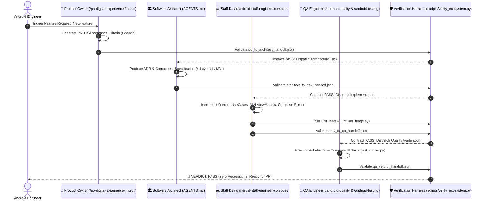

# Agentic Ecosystem 🤖📱
> **A Production-Grade Multi-Agent Framework for Modern Android Development powered by Spec-Driven Development (SDD), Deterministic Test Harnesses, and Autonomous Role Specialization.**

[](https://github.com/joshluq/agentic-ecosystem/actions)
[](https://www.python.org/)
[](https://developer.android.com)
[](AGENTS.md)
[](LICENSE)

---

## 🌟 Executive Overview

The **Agentic Ecosystem** transforms AI-assisted Android software engineering from stochastic, hallucination-prone chat into a **deterministic, verifiable engineering pipeline**. 

By orchestrating specialized agents through **machine-readable JSON Schema contracts**, structured **Markdown design specifications**, and an automated **Verification Harness**, it eliminates communication ambiguity and guarantees production-grade Jetpack Compose, Kotlin Multiplatform, and Clean Architecture standards.

```
       ┌────────────────────────────────────────────────────────┐
       │                THE TRIAD OF RIGOR                      │
       ├────────────────────────────────────────────────────────┤
       │  1. SDD (Spec-Driven Development)                      │
       │     Rigid JSON Schemas & Markdown Specifications       │
       │                                                        │
       │  2. Deterministic Test Harness                         │
       │     Automated Contract Gates & CI Verification         │
       │                                                        │
       │  3. Autonomous Specialized Agents                      │
       │     Role-Gated Personas & 10 Antigravity Skills        │
       └────────────────────────────────────────────────────────┘
```

---

## 🏛️ The Architecture: SDD + Harness + Agents



### 1. Spec-Driven Development (SDD)
- **Zero Ambiguity**: Agents never exchange free-form prompts for technical handoffs. Every stage transition is defined by a JSON Schema located in [`schemas/`](schemas/).
- **Traceability**: Requirements from the PRD receive unique IDs (`AC-001`, `FR-001`), which are strictly traced through the Architecture Decision Record (ADR), Component Spec, Kotlin implementation code, and test cases.

### 2. Deterministic Test Harness
- **Empirical Guards**: Pre-commit validation scripts (`scripts/schema_validator.py`, `scripts/verify_ecosystem.py`) enforce Draft-07 JSON Schema conformance, boundary limits, and file integrity on disk.
- **Circuit Breaker**: If any agent produces invalid contracts, compilation defects, or fails unit tests, execution halts immediately and routes to structured escalation or automated remediation.

### 3. Specialized Autonomous Agents & Skills
- Personas strictly adhere to single responsibility:
  - **Product Owner**: Defines requirements, user journeys, and business value.
  - **Architect**: Designs module boundaries, data flows, and state machines.
  - **Senior Android Dev**: Writes pure MVI UI, immutable domain models, and UseCases.
  - **QA / Debugger**: Enforces test coverage, analyzes logcat, and diagnoses ANRs.

---

## ⚡ The 11 Agentic Skills & Slash Commands

Each skill folder in [`skills/`](skills/) defines a first-class Antigravity slash command.

| Slash Command | Skill Directory | Description & Capabilities |
| :--- | :--- | :--- |
| **`/openspec`** | `skills/openspec` | **OpenSpec SDD & Living Spec Lifecycle**. Manages living specifications (`openspec/specs/`), scaffolds delta change folders (`openspec/changes/`), and merges verified deltas. |
| **`/new-feature`** | `skills/new-feature` | **End-to-End SDD Feature Pipeline**. Orchestrates PO requirements, ADR generation, 4-Layer UI implementation, and QA verification. |
| **`/fix-bug`** | `skills/fix-bug` | **Repro-First Defect Resolution**. Reproduces bugs via isolated tests, identifies root causes, applies minimal fixes, and verifies zero regressions. |
| **`/idea-lab`** | `skills/idea-lab` | **Product & Tech Incubator**. Conducts market benchmark analysis, feasibility evaluations, UX explorations, and technical spike prototypes. |
| **`/android-staff-engineer-compose`** | `skills/android-staff-engineer-compose` | **Staff-Level Jetpack Compose Engine**. Enforces MVI, 4-Layer UI architecture, CanvasKit design tokens, Navigation 3 scoping, and zero business logic in UI. |
| **`/po-digital-experience-fintech`** | `skills/po-digital-experience-fintech` | **Fintech Product Owner**. Generates comprehensive PRDs, regulatory compliance checks, Gherkin acceptance criteria, and conversion metric projections. |
| **`/senior-debugging-engineer`** | `skills/senior-debugging-engineer` | **Deep Crash & ANR Diagnostic**. Analyzes tombstone traces, memory heap dumps, coroutine deadlocks, and logcat exceptions to find root causes. |
| **`/performance-optimization-tips`** | `skills/performance-optimization-tips` | **Performance & Stability Auditing**. Detects unstable Compose lambdas, skipped recompositions, frame drops (jank), memory leaks, and disk I/O bottlenecks. |
| **`/android-device`** | `skills/android-device` | **Emulator & ADB Automation**. Launches AVDs, inspects XML view hierarchies, calculates screen tap coordinates, and executes user journey flows. |
| **`/android-quality`** | `skills/android-quality` | **Static Analysis & Defect Router**. Runs Android Lint, Detekt, and ktlint; triages errors into actionable categories (Architecture, Security, Lint). |
| **`/android-testing`** | `skills/android-testing` | **Automated Test Scaffolder**. Generates JUnit 5, MockK, Turbine state flow tests, and ComposeTestRule UI assertions with 100% AC coverage. |

---

## 📂 Repository Directory Layout

```
agentic-ecosystem/
├── .github/
│   └── workflows/
│       └── agentic-verification.yml       # Continuous Integration workflow
├── openspec/                              # OpenSpec Living Specifications & Lifecycle
│   ├── specs/                             # Permanent living source of truth
│   ├── changes/                           # Active delta changes (proposal, design, tasks)
│   └── archive/                           # Historical record of merged changes
├── schemas/                               # SDD Draft-07 JSON Schemas
│   ├── po_to_architect_handoff.schema.json
│   ├── architect_to_dev_handoff.schema.json
│   ├── dev_to_qa_handoff.schema.json
│   ├── dev_to_architect_escalation.schema.json
│   └── qa_verdict_handoff.schema.json
├── templates/                             # Standardized Markdown Contract Specs
│   ├── prd-template.md                    # Product Requirement Document
│   ├── adr-template.md                    # Architecture Decision Record
│   ├── component-spec-template.md         # 4-Layer UI & State Spec
│   ├── contract-escalation-template.md    # Dev-to-Arch Escalation
│   └── qa-report-template.md              # Quality Audit Report
├── skills/                                # Antigravity Slash Command Skills
│   ├── android-device/                    # Device & ADB automation
│   ├── android-quality/                   # Lint & static analysis
│   ├── android-staff-engineer-compose/    # Compose & MVI architecture
│   ├── android-testing/                   # Unit & UI test generators
│   ├── fix-bug/                           # Defect triage & repair protocol
│   ├── idea-lab/                          # Benchmark & feature incubation
│   ├── new-feature/                       # End-to-end SDD feature orchestrator
│   ├── performance-optimization-tips/     # Performance audit & profiling
│   ├── po-digital-experience-fintech/     # Fintech PO & PRD generator
│   └── senior-debugging-engineer/         # Crash, ANR & dump triage
├── scripts/                               # Automation & Verification Tooling
│   ├── install_to_project.py              # CLI tool to install into any Android project
│   ├── schema_validator.py                # Schema validator engine
│   ├── verify_ecosystem.py                # Master verification runner
│   └── run_walkthrough.py                 # End-to-end walkthrough demonstrator
├── tests/                                 # Automated Unittest Suite
│   ├── test_skills.py                     # Validates all skills frontmatter & integrity
│   ├── test_contracts.py                  # Validates schemas against templates
│   ├── test_scripts.py                    # Unit tests for skill helper scripts
│   ├── test_walkthrough.py                # E2E pipeline verification
│   ├── stress/                            # Empirical schema stress suites (run as scripts)
│   └── fixtures/walkthrough/              # Executed Golden Sample (FEAT-001): docs, handoffs, Kotlin src
├── docs/v2/                               # v2 roadmap & context/FinOps report
├── AGENTS.md                              # Multi-Agent Operating Charter (agent instructions)
└── README.md
```

---

## 🚀 Quickstart & Verification

### Prerequisites
- Python 3.10 or higher
- `pip install jsonschema pyyaml`

### 1. Run the Full Ecosystem Verification Harness
Execute the master validation suite to verify all 10 skills, schema contracts, empirical stress suites (79 boundary tests), and the end-to-end walkthrough pipeline:

```bash
# On Windows PowerShell:
python scripts/verify_ecosystem.py

# Or run unittest directly:
python -m unittest discover -s tests -p "test_*.py"
```

Expected output:
```text
===============================================================
   AGENTIC ECOSYSTEM — MASTER VERIFICATION RUNNER
===============================================================

[1/3] Running Skill, Contract, and Walkthrough Unittest Suite...
Ran 17 tests in 0.183s — OK
Total Tests Executed: 79 | Passed: 79 | Failed: 0

[2/3] Executing End-to-End Walkthrough Pipeline (FEAT-001)...
[STAGE 1: PO -> ARCHITECT] Validated successfully.
[STAGE 2: ARCHITECT -> DEV] Validated successfully.
[STAGE 3: DEV -> QA] Validated successfully.
[STAGE 4: QA VERDICT] Validated successfully.

===============================================================
   🎉 VERIFICATION COMPLETE: ALL GATES PASSED (100% OK)
===============================================================
```

---

## 📦 How to Bootstrap into ANY Android Project

You can install this entire agentic ecosystem into your existing Android apps (e.g., `KmSafe`, or any Jetpack Compose / Kotlin Multiplatform project) in one step:

```bash
# Clone the ecosystem repository
git clone https://github.com/joshluq/agentic-ecosystem.git

# Run the bootstrapper pointing to your Android project:
python agentic-ecosystem/scripts/install_to_project.py --target /path/to/YourAndroidApp
```

### Installation Modes
- `--mode antigravity`: Installs all 10 skills directly into `.gemini/antigravity/skills/` (enabling slash commands inside Antigravity).
- `--mode standalone`: Installs SDD schemas, contract templates, and test harnesses.
- `--mode both` *(Default)*: Full installation of skills, schemas, templates, and verification scripts.

---

## 🛡️ Escalation & Circuit Breaker Protocol

Agents never guess past a blocker: they emit a typed escalation (`schemas/dev_to_architect_escalation.schema.json`) and the harness routes it upstream. The normative protocol lives in [AGENTS.md](AGENTS.md) (§2–§3); this README is for humans only.

---

## 🤝 Contributing

1. Fork the repository.
2. Create your feature branch (`git checkout -b feature/new-skill`).
3. Ensure all tests and schemas pass (`python scripts/verify_ecosystem.py`).
4. Commit your changes (`git commit -m 'feat: add compose benchmark skill'`).
5. Push to the branch (`git push origin feature/new-skill`).
6. Open a Pull Request.

---

## 📄 License
This project is open-source under the [MIT License](LICENSE).
