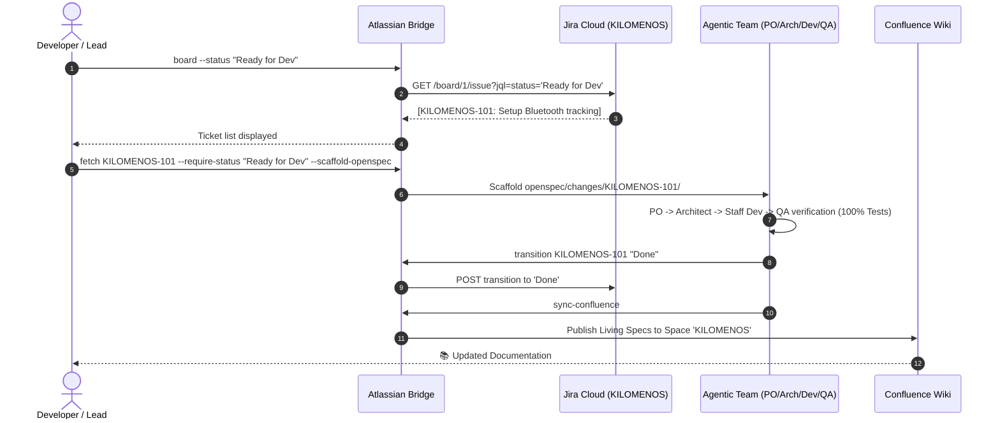

# Atlassian Cloud Integration (Jira & Confluence)

Comprehensive integration guide and CLI reference for connecting the **Android Agentic Ecosystem** with **Atlassian Jira Software** (Kanban/Scrum boards, tickets, status guards, automated defect reporting) and **Atlassian Confluence** (living architecture specifications sync).

---

## 1. Quick Setup & Credentials

Configuration is managed via local `.atlassian_config.json` in the root of the project (or via environment variables). The configuration file is ignored by Git (`.gitignore`) to keep API tokens secure.

### 1.1 How to Generate your Atlassian API Token
1. Go to: [Atlassian API Tokens Management](https://id.atlassian.com/manage-profile/security/api-tokens).
2. Click **Create API token** (`Crear token de API`).
3. Label it (e.g. `antigravity-agent`).
4. Copy the generated token string.

### 1.2 Configuration File (`.atlassian_config.json`)
Place this file in the project root:
```json
{
  "url": "https://joshluq-dev.atlassian.net",
  "email": "josh.luque@gmail.com",
  "api_token": "TU_API_TOKEN_AQUI",
  "project_key": "KILOMENOS",
  "board_id": "1",
  "confluence_space": "KILOMENOS"
}
```

Alternatively, you can set environment variables in your shell or `.env`:
- `ATLASSIAN_URL="https://joshluq-dev.atlassian.net"`
- `ATLASSIAN_EMAIL="josh.luque@gmail.com"`
- `ATLASSIAN_API_TOKEN="<token>"`
- `JIRA_PROJECT_KEY="KILOMENOS"`
- `JIRA_BOARD_ID="1"`
- `CONFLUENCE_SPACE="KILOMENOS"`

---

## 2. Command Reference (`scripts/atlassian_bridge.py`)

All commands support the `--simulate` flag to execute mock dry-runs without making live network requests.

### 2.1 Connectivity Health Check (`check`)
Tests authentication, verifies user account status, and confirms API connectivity.
```bash
# Live connection check (requires API token)
python scripts/atlassian_bridge.py check

# Simulation check (offline)
python scripts/atlassian_bridge.py --simulate check
```

---

### 2.2 Agile Board & Kanban Inspection (`board`)
Inspects active tickets on a specific Jira Agile Kanban or Scrum board.
```bash
# List all tickets on the configured board
python scripts/atlassian_bridge.py board

# Filter tickets in a specific Kanban column / status
python scripts/atlassian_bridge.py board --status "Ready for Dev"

# Filter by project key or specific board ID
python scripts/atlassian_bridge.py board --board-id 1 --project-key KILOMENOS --status "In Progress"

# Simulation mode
python scripts/atlassian_bridge.py --simulate board --status "Ready for Dev"
```

---

### 2.3 Ticket Fetch & OpenSpec Scaffolding (`fetch`)
Downloads ticket details (summary, description, criteria, status, priority). Can enforce state guards and auto-scaffold an OpenSpec proposal.
```bash
# Basic fetch
python scripts/atlassian_bridge.py fetch KILOMENOS-101

# Fetch with Status Guard (Blocks execution if ticket is not yet ready)
python scripts/atlassian_bridge.py fetch KILOMENOS-101 --require-status "Ready for Dev"

# Fetch, validate status, and automatically create OpenSpec proposal:
python scripts/atlassian_bridge.py fetch KILOMENOS-101 --require-status "Ready for Dev" --scaffold-openspec

# Simulation mode
python scripts/atlassian_bridge.py --simulate fetch KILOMENOS-101 --require-status "Ready for Dev"
```

---

### 2.4 PO Refinement & Acceptance Criteria Injection (`refine`)
Allows the **Product Owner agent** to enrich an existing draft ticket with formal Gherkin Acceptance Criteria, technical constraints, and move it to a refined state.
```bash
# Refine using an existing specification markdown file
python scripts/atlassian_bridge.py refine KILOMENOS-101 openspec/changes/FEAT-001/proposal.md --status "Ready for Dev"

# Refine with inline text
python scripts/atlassian_bridge.py refine KILOMENOS-101 "Acceptance Criteria:\n- AC-1: Export button emits valid PDF\n- AC-2: Error snackbar displayed on failure" --status "Ready for Dev"

# Simulation mode
python scripts/atlassian_bridge.py --simulate refine KILOMENOS-101 "Criteria content" --status "Ready for Dev"
```

---

### 2.5 Workflow Status Transitions (`transition`)
Moves a ticket through the team's Jira workflow lifecycle.
```bash
# Mark ticket as In Progress
python scripts/atlassian_bridge.py transition KILOMENOS-101 "In Progress"

# Send ticket to QA / Verification
python scripts/atlassian_bridge.py transition KILOMENOS-101 "Code Review"

# Mark ticket as Done
python scripts/atlassian_bridge.py transition KILOMENOS-101 "Done"

# Simulation mode
python scripts/atlassian_bridge.py --simulate transition KILOMENOS-101 "Done"
```

---

### 2.6 Human-in-the-Loop Feedback Comments (`comment`)
Posts clarification questions, architectural decisions, or status updates to a ticket.
```bash
# Ask for clarification or human feedback
python scripts/atlassian_bridge.py comment KILOMENOS-101 "Architect Agent: Bluetooth background scanning requires ACCESS_BACKGROUND_LOCATION permission. Please confirm if required for MVP."

# Post implementation notes
python scripts/atlassian_bridge.py comment KILOMENOS-101 "Staff Engineer: Implemented MVI Contract and Compose UI. 100% unit tests passing."

# Simulation mode
python scripts/atlassian_bridge.py --simulate comment KILOMENOS-101 "Automated test comment"
```

---

### 2.7 Automated Bug & Defect Reporting (`report-crash`)
Automatically creates a high-priority Jira Bug ticket from a QA defect JSON file or Crash Triage report.
```bash
# File Jira Bug from defect ticket
python scripts/atlassian_bridge.py report-crash KILOMENOS walkthrough/artifacts/DEFECT-001.json

# Simulation mode
python scripts/atlassian_bridge.py --simulate report-crash KILOMENOS walkthrough/artifacts/DEFECT-001.json
```

---

### 2.8 Living Specifications Sync to Confluence (`sync-confluence`)
Publishes all Markdown living specifications from `openspec/specs/` into the project's Confluence Space as living documentation pages.
```bash
# Publish living specs to the configured Confluence space
python scripts/atlassian_bridge.py sync-confluence

# Publish to a specific space key
python scripts/atlassian_bridge.py sync-confluence KILOMENOS

# Simulation mode
python scripts/atlassian_bridge.py --simulate sync-confluence
```

---

## 3. End-to-End Multi-Agent Lifecycle


