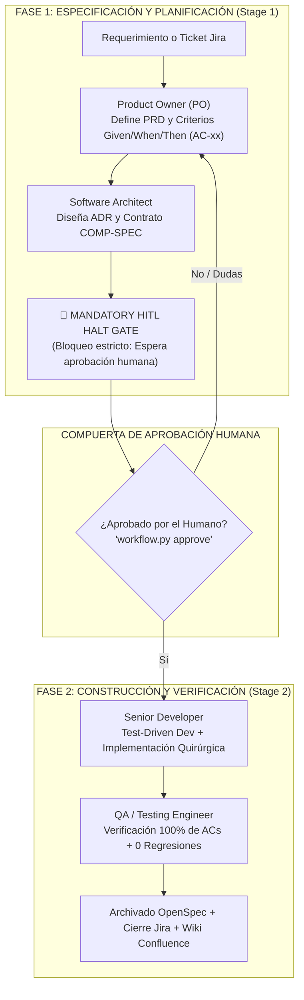

# Guía Integral de Uso del Ecosistema Agéntico (v2.0)

Bienvenido a la guía oficial de referencia y operación del **Agentic Ecosystem**. Este ecosistema está diseñado bajo el paradigma de **Specification-Driven Development (SDD)**, eliminando la ambigüedad, el código no solicitado (*ghost code*) y el parloteo conversacional (*chatter*) en proyectos de software multidisciplinares (**Android, Backend y Web**).

---

## 1. Filosofía Central: Specification-Driven Development (SDD)

El ecosistema opera bajo una premisa inquebrantable: **"No Spec, No Code"**. Ningún agente tiene autorización para crear o modificar código fuente en producción sin una especificación formal y aprobada.



### Los 4 Pilares del Protocolo SDD
1. **Spec-First & Zero Ghost Code**: Prohibido agregar campos ocultos, pantallas no documentadas o lógica fantasma. Todo cambio debe rastrearse a `BR-xx` (Business Rules), `FR-xx` (Functional Requirements) y `AC-xx` (Acceptance Criteria).
2. **Dual Artifacts (Artefactos Duales)**: Toda transición entre agentes genera:
   - Un documento Markdown legible por humanos (`proposal.md`, `design.md`, `PRD.md`).
   - Un payload JSON estructurado validado contra esquemas Draft-07 (`po_to_architect_handoff.json`, etc.).
3. **Chatter Elimination Protocol**: Cero transiciones habladas o preguntas en bucle. Los agentes se comunican exclusivamente persistiendo artefactos validados en disco.
4. **HITL 2-Stage Lifecycle**: Separación estricta entre diseñar la solución (Fase 1) y ejecutarla (Fase 2).

---

## 2. Catálogo de Agentes y Roles de Ciclo de Vida

Los agentes están definidos formalmente en [`AGENTS.md`](file:///c:/Users/josh_/.gemini/antigravity/scratch/agentic_ecosystem/AGENTS.md) y en los perfiles de plataforma (`packs/<plataforma>/roles/`):

| Rol Identificador | Título | Dominio | Responsabilidad Principal |
|---|---|---|---|
| `product_owner` | Product Owner (PO) | Universal | Traduce requerimientos en PRDs, define escenarios Given/When/Then y emite `po_to_architect`. |
| `solutions_architect` | Solutions Architect | Macro / Cross-Platform | Define estrategia global, seguridad, contratos API y arquitectura macro entre plataformas. |
| `ecosystem_optimizer` | Ecosystem Optimizer & AgentOps | Gobernanza | Audita presupuestos de tokens, pureza de plataformas, sincronización Hub-Spoke y deriva. |
| `software_architect` | Mobile Software Architect | Android | Diseña ADRs móviles, patrones MVI, contratos `COMP-SPEC` y define State/Action flows. |
| `senior_android_developer` | Senior Android Developer | Android | Implementa código Kotlin/Compose con 100% pruebas unitarias (Turbine, MockK) y compila limpio. |
| `qa_testing_engineer` | Android QA Engineer | Android | Ejecuta pruebas UI, verifica el 100% de los criterios de aceptación y emite el veredicto QA. |
| `backend_architect` | Backend Software Architect | Backend | Diseña esquemas PostgreSQL, políticas RLS, Deno Edge Functions y migraciones atómicas. |
| `web_architect` | Web Software Architect | Web | Diseña arquitectura Astro SSG, optimización SEO/Lighthouse y cumplimiento legal. |

### Subagentes Disponibles
- **`self`**: Invoca una subtarea heredando la configuración completa de herramientas y modelo en un contexto conversacional aislado.
- **`research`**: Subagente optimizado para lectura y exploración de código sin permisos de escritura, ideal para investigaciones pesadas sin saturar el contexto principal.
- **`manifest`**: Genera prompts de despacho aislado con presupuesto de contexto precalculado (`python scripts/workflow.py manifest <role>`).

---

## 3. Catálogo Completo de Skills

Los skills residen en `.agents/skills/` y se cargan mediante **Progressive Disclosure** (solo se cargan en memoria completa cuando el flujo lo requiere).

### A. Skills Universales del Core (`CORE_SKILLS`)
Instalados en todos los proyectos satélite (Android, Backend, Web):
- **`openspec`**: Gestión del ciclo de vida de especificaciones vivas, deltas de cambio y archivado histórico.
- **`atlassian-bridge`**: Conexión con Jira y Confluence (tableros Kanban, transiciones, comentarios HITL y sync).
- **`idea-lab`**: Incubadora de producto y benchmarking competitivo antes de escribir especificaciones (matriz ICE/RICE).
- **`ecosystem-optimizer`**: Auditor de salud agéntica (presupuestos de contexto, linters de fugas de dominio y sincronización).
- **`skill-creator`**: Wizard interactivo y validador para crear nuevos skills locales en los proyectos.
- **`ecosystem-evolution`**: Radar de actualización tecnológica y mejores prácticas (modo Read-Only estricto).
- **`confluence-wiki-docs`**: Generador y sincronizador de wikis en Confluence con taxonomía de 4 pilares (Conceptos, Entidades, Features, Flows).

### B. Skills Especializados por Plataforma
- **Android**:
  - `android-staff-engineer-compose`: Arquitectura de UI Jetpack Compose, MVI, tokens y recomposición eficiente.
  - `android-testing`: Scaffolding y ejecución de pruebas unitarias (JUnit, MockK, Turbine) y de UI con Compose.
  - `android-device`: Control de emuladores Android, inspección ADB y ejecución de journeys de prueba.
  - `android-quality`: Linters estáticos (ktlint, Android Lint), análisis de crashes Logcat y triaje ANR.
  - `po-digital-experience-fintech`: Estrategias de activación, retención y diseño UX para aplicaciones B2C.
- **Backend**:
  - `supabase-db-triage`: Modelado PostgreSQL, políticas RLS idempotentes e índices de alto rendimiento.
  - `supabase-edge-functions`: Desarrollo y testing de Edge Functions en TypeScript/Deno.
- **Web**:
  - `web-lighthouse-seo`: Optimización estricta para puntuación 100/100 en Google Lighthouse, SEO y WCAG AA.
- **Transversales / Diagnóstico**:
  - `new-feature`: Pipeline agnóstico para construcción de features con especificación.
  - `fix-bug`: Protocolo quirúrgico de resolución de bugs mediante test de reproducción previo.
  - `senior-debugging-engineer`: Diagnóstico profundo de fallos complejos en entornos de producción.
  - `performance-optimization-tips`: Optimización algorítmica ($O(1)$ vs $O(N^2)$), gestión de memoria y contención de queries.
  - `legal-compliance-audit`: Auditoría de políticas de privacidad, términos de servicio y requisitos de Google Play y App Store.

---

## 4. Herramientas CLI y Comandos Maestros

| Comando | Sintaxis de Ejemplo | Descripción |
|---|---|---|
| **Orquestador SDD** | `python scripts/workflow.py plan FEAT-01 --title "Sync Push"` | Inicia Fase 1: extrae requerimiento, crea OpenSpec y activa el Halt Gate. |
| **Aprobación Humana** | `python scripts/workflow.py approve FEAT-01` | Aprueba formalmente la propuesta (requisito previo a Fase 2). |
| **Construcción** | `python scripts/workflow.py build FEAT-01` | Inicia Fase 2: valida compuerta, pasa Jira a In Progress y emite handoff dev. |
| **Verificación QA** | `python scripts/workflow.py verify FEAT-01 --verdict PASS` | Finaliza ciclo: consolida especificación en living specs y cierra ticket. |
| **Estado del Ciclo** | `python scripts/workflow.py status` | Muestra estado de cambios activos y compuertas pendientes. |
| **Auditoría de Salud** | `python scripts/workflow.py audit` | Audita presupuesto de tokens, pureza de plataformas y schemas Draft-07. |
| **Instalador de Spokes** | `python scripts/install_to_project.py --target ../MiApp --profile android` | Despliega el ecosistema adaptado con el perfil deseado en un nuevo repo. |
| **Atlassian Bridge** | `python scripts/atlassian_bridge.py board --status "Ready for Dev"` | Consulta tickets listos para entrar al flujo en Jira. |
| **Creador de Skills** | `python skills/skill-creator/scripts/scaffold_skill.py --name mi-skill` | Crea un nuevo skill estandarizado y validado. |
| **Confluence Wiki** | `python skills/confluence-wiki-docs/scripts/sync_wiki_tree.py --space KMSAFE` | Publica la wiki estructurada en 4 pilares en Confluence. |
| **Radar de Evolución** | `python skills/ecosystem-evolution/scripts/audit_ecosystem_evolution.py` | Ejecuta diagnóstico de obsolescencia agéntica (Read-Only). |

---

## 4.1 Correlación: Lenguaje Natural $\leftrightarrow$ Slash Commands $\leftrightarrow$ Comandos CLI

El desarrollador o Product Owner no necesita memorizar la sintaxis de terminal. Puedes comunicarte en el chat mediante **lenguaje natural** o **slash commands** (`/`), y el agente ejecutará internamente el comando CLI maestro correspondiente:

| Comando en Lenguaje Natural (Chat) | Slash Command (`/`) | Comando CLI Determinista (Subyacente) | Acción Orquestada por el Agente |
| :--- | :---: | :--- | :--- |
| *"Refina el ticket KMSAFE-10"*,<br>*"Planifica la feature de login"*,<br>*"Crea la propuesta para FEAT-02"* | `/new-feature`<br>`/opsx propose` | `python scripts/workflow.py plan <KEY> --title "..."` | Ingesta el requerimiento, genera `proposal.md`, emite contratos y activa el **Halt Gate**. |
| *"Aprobado"*,<br>*"Apruebo la propuesta"*,<br>*"Proceder con la implementación"* | N/A (HITL Gate) | `python scripts/workflow.py approve <KEY>` | Firma la compuerta humana en `proposal.md` y autoriza el inicio de la Fase 2. |
| *"Implementa la funcionalidad"*,<br>*"Construye FEAT-02"*,<br>*"Empieza a programar"* | `/opsx apply` | `python scripts/workflow.py build <KEY>` | Valida la compuerta, transiciona Jira a *In Progress*, emite `dev_to_qa.json` y codifica bajo TDD. |
| *"Verifica las pruebas de FEAT-02"*,<br>*"Pasa QA y archiva"* | `/opsx archive` | `python scripts/workflow.py verify <KEY> --verdict PASS` | Audita 100% de ACs, emite `qa_verdict.json`, consolida living specs y cierra el ticket en Jira. |
| *"¿Cómo va el proyecto?"*,<br>*"Estado del pipeline"* | `/opsx status` | `python scripts/workflow.py status` | Muestra el estado del ciclo de vida y compuertas activas. |
| *"Audita el presupuesto de contexto"*,<br>*"Revisa la salud del sistema"* | `/ecosystem-optimizer` | `python scripts/workflow.py audit` | Audita tokens, pureza de plataformas (0 fugas) y contratos Draft-07. |
| *"Corrige el crash al pulsar guardar"*,<br>*"Hay un bug en la pantalla X"* | `/fix-bug` | `python scripts/workflow.py ...`<br>+ `sanity_check.py` | Escribe primero un test unitario que reproduce el fallo y aplica corrección quirúrgica. |
| *"Explora cómo monetizar esta idea"*,<br>*"Benchmarking de competidores para X"* | `/idea-lab` | Lógica interna de `idea-lab` | Analiza psicología del usuario y evalúa hipótesis con el scorecard ICE/RICE. |
| *"Crea un nuevo skill para deploy staging"* | `/skill-creator` | `python skills/skill-creator/scripts/scaffold_skill.py ...` | Entrevista interactiva, scaffolding de carpetas y validación de frontmatter YAML. |
| *"Publica la documentación en Confluence"*,<br>*"Sincroniza la wiki del proyecto"* | `/confluence-wiki-docs` | `python skills/confluence-wiki-docs/scripts/sync_wiki_tree.py --space <KEY>` | Extrae y publica el árbol de 4 pilares (Conceptos, Entidades, Features, Flows) en Confluence. |
| *"¿Está actualizado nuestro ecosistema con el estado del arte agéntico?"* | `/ecosystem-evolution` | `python skills/ecosystem-evolution/scripts/audit_ecosystem_evolution.py` | Diagnóstico frente a fuentes canónicas (Antigravity, MCP, DeepMind) en modo Read-Only. |

---

## 5. Ejemplos Prácticos de Flujo de Trabajo

### Caso 1: Instalar el Ecosistema en un Nuevo Proyecto
Para conectar un nuevo repositorio (por ejemplo, una app Android `KmSafe` o un backend Supabase):

```powershell
# 1. Desde el repositorio del ecosistema, instalar en el proyecto destino
python scripts/install_to_project.py --target ../KmSafe --profile android --mode both

# 2. Configurar credenciales en el nuevo proyecto
cd ../KmSafe
cp .atlassian_config.json.example .atlassian_config.json
# Editar URL, email, token y project_key

# 3. Verificar que el Spoke está sincronizado
python scripts/workflow.py audit
```

---

### Caso 2: Construir una Nueva Funcionalidad (Flujo SDD Completo)

#### Paso 1: Planificación e Ingesta (Fase 1)
El usuario pide: *"Implementa la funcionalidad FEAT-102 para calcular la autonomía restante del vehículo"*.

```powershell
# El agente o desarrollador ejecuta la planificación:
python scripts/workflow.py plan FEAT-102 --title "Calculo Autonomia Vehiculo"
```
- Se genera la propuesta en `openspec/changes/FEAT-102/` (`proposal.md`, `design.md`, `tasks.md`).
- Se emiten los payloads validados `po_to_architect_FEAT-102.json` y `architect_to_dev_FEAT-102.json`.
- **🛑 HALT GATE ACTIVADO**: El sistema se detiene y espera revisión humana.

#### Paso 2: Aprobación Humana (HITL Gate)
El Product Owner o Lead revisa la propuesta y aprueba formalmente:
```powershell
python scripts/workflow.py approve FEAT-102
```

#### Paso 3: Construcción (Fase 2)
```powershell
python scripts/workflow.py build FEAT-102
```
- Se valida que la compuerta esté firmada y no haya dudas abiertas.
- El desarrollador implementa la lógica respetando estrictamente el `COMP-SPEC`.
- Se ejecutan pruebas unitarias: `sanity_check.py` o `./gradlew test`.

#### Paso 4: Verificación QA y Cierre (Fase 3)
```powershell
python scripts/workflow.py verify FEAT-102 --verdict PASS
```
- Se genera el reporte QA y el payload `qa_verdict_FEAT-102.json`.
- La especificación de cambio se consolida automáticamente en las especificaciones vivas (`openspec/specs/`).

---

### Caso 3: Corrección Quirúrgica de un Bug (Bugfix Protocol)

Cuando ocurre un defecto en producción, se activa el skill `fix-bug`:

1. **Aislamiento**: Se identifica el fallo a través de logs (`logcat_triage.py` o crash report).
2. **Reproducción (Test Primero)**: Se escribe un test unitario que **reproduce el error y falla**:
   ```kotlin
   @Test
   fun bug_reproduce_null_pointer_when_bluetooth_disconnects() = runTest {
       // Este test debe fallar inicialmente confirmando el bug
   }
   ```
3. **Corrección Quirúrgica**: Se aplica el cambio mínimo indispensable en el código productivo sin añadir refactorizaciones no solicitadas.
4. **Verificación**: Se ejecutan las pruebas completas para confirmar que el test antes fallido ahora pasa y ninguna otra prueba se rompió.

---

### Caso 4: Documentar el Proyecto en Confluence (Wiki de 4 Pilares)

Para publicar la arquitectura completa del proyecto en Confluence:

```powershell
# 1. Previsualizar la estructura detectada en el repositorio
python skills/confluence-wiki-docs/scripts/sync_wiki_tree.py --scan-only

# 2. Probar en modo simulado (Dry-Run)
python skills/confluence-wiki-docs/scripts/sync_wiki_tree.py --dry-run

# 3. Publicar la wiki jerárquica en el espacio Confluence
python skills/confluence-wiki-docs/scripts/sync_wiki_tree.py --space KMSAFE
```

El resultado en Confluence será un árbol ordenado:
- **1. 🧠 Conceptos**: Glosario del negocio y reglas `BR-xx`.
- **2. 🗄️ Entidades**: Modelos de base de datos y esquemas JSON.
- **3. 🚀 Features**: Historias de usuario y criterios de aceptación actualizados.
- **4. 🔄 Flows**: Diagramas de secuencia y flujos de estados del sistema.
