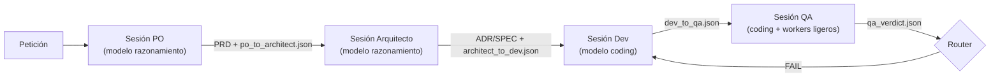

# Informe de mejora: gestión de contexto y FinOps en `android-agentic-ecosystem`

## 0. Resumen
Las tres hipótesis tienen respaldo en las prácticas actuales de *context engineering*. Además, la plantilla ya tiene buena base: handoffs JSON validados con Draft‑07, OpenSpec como SSOT y `workflow.py plan/build`. Esa base permite **aislar cada etapa en una sesión propia**. El problema está en la capa de instrucciones: los handoffs son deterministas, pero las instrucciones se cargan de forma monolítica y siempre en el mismo chat.

| Hipótesis | ¿Se sostiene? | Hallazgo principal en la plantilla |
|---|---|---|
| 1. Secuencial en un solo chat = overflow | **Sí** | `AGENTS.md` (~35 KB ≈ 9k tokens) se inyecta como regla global en *todas* las etapas, junto con los skills y el historial acumulado |
| 2. Modelo por tarea, cuidando la caché | **Sí, con matices** | No hay política de modelos; cambiar de modelo dentro de una sesión rompe la caché |
| 3. Los modelos actuales necesitan menos instrucciones | **Sí** | Gran parte de `AGENTS.md` y de los skills explica buenas prácticas genéricas (UDF, Dispatchers, Given/When/Then) que el modelo ya sabe aplicar |

---

## 1. Evidencia que respalda tus hipótesis

### H1 — Ejecución secuencial en un solo chat
- **Context rot**: el rendimiento baja a medida que crece el contexto, mucho antes de llenar la ventana. Anthropic (*Effective context engineering for AI agents*, 2025) y Chroma (*Context Rot*, 2025) lo miden: la precisión cae al añadir tokens irrelevantes, incluso en tareas sencillas.
- **Las cuatro estrategias** (Write / Select / Compress / Isolate, LangChain 2025):
  - **Isolate**: usar subagentes con contexto limpio que devuelven un resumen condensado.
  - **Write**: guardar el estado fuera de la ventana de contexto.
- **El coste crece rápido con la longitud del chat**: cada turno vuelve a enviar todo el prefijo. Un chat PO→Arq→Dev→QA reprocesa el PRD, el ADR, los logs de Gradle, etc., en cada llamada. Aunque la caché abarate la lectura, el contexto inútil sigue empeorando la calidad.
- **Conclusión**: si el handoff es determinista y está en disco, **el historial de chat de la etapa anterior es ruido**. El JSON más los artefactos `.md` *son* la memoria. Eso es justo el patrón "Write + Isolate".

### H2 — Modelo por tarea frente a caché
- **Routing**: lo habitual es usar un modelo frontier para planificar, revisar y diseñar, y modelos pequeños o rápidos para tareas repetitivas (lint triage, generación de scaffolds, resumir logs). Así lo recomiendan Anthropic (patrón orquestador + workers) y LangChain (el routing vive en el *harness*).
- **Matiz de caché (tienes razón)**: la caché de prompts depende del **modelo y del prefijo exacto**. Si cambias de modelo *dentro* de una conversación, el siguiente turno paga el prefijo completo sin descuento. Las lecturas en caché cuestan ~10 % del precio de entrada en Anthropic, y Gemini también ofrece descuentos por contexto en caché.
- **Regla práctica**: **un modelo por sesión o etapa, nunca a mitad de una sesión**. Como la H1 ya aísla cada etapa en su propia sesión, el cambio de modelo cae justo en la frontera, donde la caché se perdería igualmente. Las dos hipótesis se refuerzan entre sí.
- Además, con TTL de caché cortos (por ejemplo, 5 min por defecto en Anthropic), las pausas HITL largas invalidan la caché. Es otro argumento para no alargar una sesión durante la revisión humana.

### H3 — Menos instrucciones, más lineamientos propios
- Las guías de prompting de Anthropic para Claude 4.x y las de OpenAI para GPT‑5 coinciden:
  - Los modelos recientes siguen las instrucciones **de forma literal y precisa**.
  - Prompts demasiado enfáticos ("NEVER", "MUST", mayúsculas) provocan **sobre‑corrección**.
  - Es más eficaz explicar *por qué* y dar **ejemplos (few‑shot)** que listar reglas genéricas.
- Recomendación de Anthropic: un "system prompt mínimo con la información suficiente". Encontrar la "altitud correcta": ni lógica *hardcodeada* ni vaguedades.
- **Qué no recortar** (para que la hipótesis no se lleve demasiado lejos):
  - Las convenciones **propias del proyecto** (FoundationKit, `ScreenViewModel<State,Event,Effect>`, CanvasKit, Navigation 3, nombres de módulos).
  - Los **contratos verificables por máquina** (schemas, gates).

  Eso es lo que el modelo *no* puede saber. Lo que sí sobra es la pedagogía genérica.

> [!NOTE]
> Las fuentes citadas son referencias públicas de 2025 (Anthropic Engineering, LangChain Blog, Chroma Research, documentación de prompt caching de Anthropic y Google). Las cifras de tokens del proyecto se estimaron como bytes/4.

---

## 2. Diagnóstico de la plantilla actual

### 2.1 Huella de contexto (estimada)
| Fuente | Tamaño | ¿Cuándo se carga? | Problema |
|---|---|---|---|
| `AGENTS.md` (raíz) | 35 KB ≈ 9k tok | **Siempre** (user rule) | Incluye los 9 roles (Backend y Web incluidos) en una sesión Android |
| `profiles/backend/AGENTS.md` | 36 KB | Por perfil | Duplica estructura del raíz |
| `profiles/android/AGENTS.md` | 31 KB | Por perfil | Casi idéntico al raíz → riesgo de doble carga |
| `PROJECT.md` + `README.md` | 28 KB | A menudo | Mezcla documentación humana con instrucciones para el agente |
| `android-staff-engineer-compose/SKILL.md` | 11 KB | Dev | Correcto (bajo demanda), pero verboso |
| `android-quality`, `android-testing`, `android-device` | 8 KB c/u | QA | Se suman en el mismo chat si no hay aislamiento |
| `.agents/*/handoff.md` (spec_miner) | 45 KB c/u | Si el agente explora | Restos de la construcción de la plantilla; contaminan búsquedas |
| `walkthrough/`, `tests/*stress*` (≈100 KB) | — | Si el agente explora | Ruido para el grep y la exploración |

**Escenario actual (1 chat, ciclo completo)**: ~9k (regla) + ~25–35k (skills acumulados) + artefactos y logs de Gradle/tests + historial. Con facilidad se superan **80–150k tokens** al llegar a QA, y cada turno de QA vuelve a enviar todo el trabajo del PO.

### 2.2 Puntos fuertes (conservar)
- Handoffs **tipados y validados** (`schemas/*.schema.json`), que ya sirven como frontera de contexto.
- `workflow.py plan|build` como harness determinista.
- Skills con `scripts/` que trasladan trabajo a código (lint/logcat triage): resultados pequeños y deterministas que el agente lee en lugar de logs completos.
- Ya existen `audit_context_budget.py` y `audit_context_pruning.py`, pero no imponen un límite de contexto por etapa.

### 2.3 Brechas
1. **No hay frontera de sesión entre roles**: el diagrama de `AGENTS.md` es un pipeline, pero en la práctica se ejecuta en un mismo chat.
2. **Regla global monolítica**: cada rol carga las restricciones de todos los roles.
3. **No hay política de modelos** por etapa.
4. **Instrucciones genéricas redundantes**, por ejemplo:
   - "NEVER hardcode Dispatchers"
   - "Given/When/Then"
   - "Immutable state"
   - TLS / RLS explicados

   Además, hay exceso de `NEVER/MUST` en mayúsculas.
5. **Pocos ejemplos few‑shot concretos** del proyecto (un `UiState`, un `ScreenViewModel` o un handoff "golden" reales).
6. **Ruido en el workspace** (`.agents/`, `walkthrough/`, `ORIGINAL_REQUEST.md` duplicado).

---

## 3. Plan de mejora

### P1 — Aislar etapas en sesiones o subagentes (impacto alto)

- Cada etapa **arranca en limpio** y su entrada es **solo** el JSON de handoff más las rutas que referencia. No hereda historial.
- `workflow.py` emite un `context_manifest` por etapa: la lista de archivos y skills permitidos para esa etapa.
- Patrón orquestador: un agente ligero lee el handoff y lanza un subagente por rol. El subagente devuelve **solo** la ruta del artefacto y un resumen de ≤200 tokens.
- QA delega a workers la ejecución de Gradle, lint y logcat, que devuelven el JSON de triage y no el log crudo.

### P2 — Política de modelos alineada con la caché (impacto alto en coste)
| Etapa | Perfil de modelo | Motivo |
|---|---|---|
| PO / refinamiento | Frontier con razonamiento (esfuerzo medio) | Ambigüedad, criterios de aceptación |
| Arquitecto | Frontier con razonamiento alto | Contratos y fronteras: el coste de un error aquí se arrastra a todas las etapas siguientes |
| Developer | Modelo fuerte en coding (esfuerzo bajo/medio) | Implementación guiada por contrato |
| Workers repetitivos (scaffold de tests, lint/logcat triage, resúmenes, Jira) | Modelo ligero/flash | Volumen alto, poca ambigüedad |
| QA (veredicto) | Coding/razonamiento medio | Juicio sobre la trazabilidad de los AC |

Reglas de caché:
- No cambiar de modelo dentro de una sesión.
- Prefijo estable al inicio: regla mínima → skill del rol → handoff. Lo variable va al final.
- Evitar timestamps o IDs dinámicos en los system prompts.
- Declararlo en un `models.yaml` que lea `workflow.py`.

### P3 — Adelgazar las instrucciones (impacto alto en calidad y coste)
- **`AGENTS.md` raíz → índice de ≤2–3k tokens**: tabla de roles (una línea cada uno), la máquina de estados y punteros a `roles/<rol>.md`, que se cargan solo en su etapa.
- **Eliminar** la pedagogía genérica y **conservar** solo los lineamientos propios: FoundationKit, CanvasKit, Navigation 3, nombres de módulos, variantes `devDebug`, convenciones de Jira y OpenSpec.
- **Convertir reglas en código**: lo que un gate ya verifica (schema, `compilation_clean`, `ktlint`, ciclo ≤3) no necesita prosa repetida. Basta con decir "el gate X lo valida".
- **Few‑shot**: `examples/` con 1 `UiState`/`Action`/`ScreenViewModel` canónico de KiloMenos y 1 handoff de referencia por schema. Sustituyen párrafos de reglas.
- **Role prompting breve**: 2–3 líneas de identidad y criterio de éxito por rol, sin listas de "NEVER" en mayúsculas. Indicar el *porqué* en una línea.
- Dejar de cargar los perfiles Backend/Web en proyectos Android: `install_to_project.py` debería instalar solo el perfil elegido.

### P4 — Higiene del workspace (impacto medio, esfuerzo bajo)
- Mover `.agents/`, `walkthrough/` y los tests de estrés fuera de la ruta que explora el agente, o añadirlos a un fichero de ignore para agentes.
- Separar `README.md` (para humanos) de las instrucciones para el agente.
- Deduplicar `ORIGINAL_REQUEST.md` y `profiles/android/*` respecto a la raíz.

### P5 — FinOps medible (impacto medio)
- Ampliar `audit_context_budget.py` con un **presupuesto por etapa** (por ejemplo, prefijo ≤8k tokens) que falle en CI.
- Registrar por etapa: tokens de entrada, salida y caché, modelo y coste, en `handoffs/*.json` (campo opcional `telemetry`).
- KPI: coste por feature, tasa de acierto de caché y número de ciclos de remediación.

---

## 4. Impacto estimado (orden de magnitud)
| Métrica | Actual (1 chat) | Propuesto |
|---|---|---|
| Prefijo fijo por turno | ~9k + skills acumulados | ~2–4k por etapa |
| Contexto en QA | 80–150k | 15–30k |
| Coste por feature | 1× | ~0,3–0,5× (aislamiento + routing + caché) |
| Riesgo de context rot | Alto en Dev/QA | Bajo |

> [!IMPORTANT]
> Son estimaciones. Antes de migrar, conviene medir 2–3 features reales con la telemetría de P5 para validar el ahorro.

## 5. Hoja de ruta
1. **Semana 1**: P4 (higiene) + presupuesto por etapa en `audit_context_budget.py`.
2. **Semana 2**: P3 (dividir `AGENTS.md` en un índice y `roles/*.md`, más `examples/`).
3. **Semana 3**: P1 (`context_manifest` y lanzamiento por subagente en `workflow.py`).
4. **Semana 4**: P2 (`models.yaml`) + telemetría P5 y comparativa antes/después.

---

## 6. Estructura de repositorio: un repo vs. tres repos (añadido el 2026-10-05)

**Decisión**: un **monorepo con núcleo y packs instalables** (opción C), renombrado a **`agentic-ecosystem`**. No se divide en tres repos.

| Opción | Contexto/FinOps | Mantenimiento | Alineación |
|---|---|---|---|
| A. Tres repos independientes | Bueno | ❌ Triple | ❌ Desviación casi segura (schemas copiados tres veces) |
| B. Monorepo actual | ❌ Fuga de Backend/Web hacia Android | Bueno | Bueno |
| **C. Monorepo con núcleo y packs** ✅ | ✅ Solo núcleo + un pack | ✅ Un único sitio | ✅ Schemas versionados en un lugar |
| D. Repo del núcleo + repos de packs | ✅ | Medio | Medio (necesita versionado) |

**Motivo**: lo que cuesta contexto es lo que se *instala* en el proyecto destino, no el número de repos. Los schemas de handoff y los contratos entre plataformas son el punto de alineación y deben existir una sola vez.

```
agentic-ecosystem/
├── core/            # índice AGENTS, schemas, workflow.py, openspec, jira
│   └── contracts/   # FCM, DTOs: fuente única entre plataformas
├── packs/{android,backend,web}/   # roles/*.md, skills, examples, gates
└── scripts/install_to_project.py --pack android --version X.Y.Z
```
- Semver del núcleo + `schema_version` + `requires_core` en cada pack.
- `.agentic.lock` en el destino, que sustituye a `validate_spokes_sync.py`.
- CI única: un cambio en `core/` ejecuta los tests de todos los packs.
- **Criterios para pasar a la opción D**: equipos o ritmos de publicación distintos por plataforma, permisos de acceso distintos, o una CI que bloquee a otros packs.

**Orden**: hacer la reestructuración núcleo/packs **antes** de dividir `AGENTS.md` (P3), para dividirlo una sola vez y ya en su sitio definitivo.

## 7. Gobierno de la v2
- Rama `v2`. **Congelación de propagación**: `PROPAGATION_FREEZE.md` + guard en `install_to_project.py` (exit 2).
- Seguimiento: `docs/v2/ROADMAP-V2.md`.
