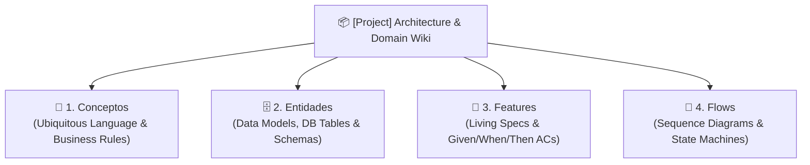

# Confluence Wiki Documentation Skill (4-Pillar Taxonomy)

The `confluence-wiki-docs` skill transforms repository specifications, schemas, ADRs, and domain rules into a living, navigable **Wiki in Atlassian Confluence**, structured across 4 functional pillars: **Conceptos, Entidades, Features y Flows**.

---

## 1. The 4-Pillar Information Architecture



| Pillar | Focus | Extraction Source |
|---|---|---|
| **🧠 Conceptos** | Ubiquitous language, domain dictionary, and cross-cutting business rules (`BR-xx`). | `PROJECT.md`, `openspec/specs/domain/` |
| **🗄️ Entidades** | Database schemas, table columns, constraints, and JSON contracts. | `schemas/*.json`, `supabase/migrations/` |
| **🚀 Features** | Consolidated living specs, user stories, and acceptance criteria (`AC-xx`). | `openspec/specs/*.md` |
| **🔄 Flows** | Sequence diagrams, integration journeys, and ViewModel MVI state machines. | `docs/adr/`, `AGENTS.md` |

---

## 2. Synchronization Modalities

### Modality A: Automated Tree Synchronization (CLI Script)
The bundled script scans repository artifacts, categorizes pages, and synchronizes the complete 4-pillar tree with idempotent page creation and updating:

```powershell
# 1. Preview the wiki tree structure without publishing
python skills/confluence-wiki-docs/scripts/sync_wiki_tree.py --scan-only

# 2. Simulate synchronization (Dry-Run mode)
python skills/confluence-wiki-docs/scripts/sync_wiki_tree.py --dry-run

# 3. Synchronize to a specific Confluence space
python skills/confluence-wiki-docs/scripts/sync_wiki_tree.py --space KMSAFE
```

### Modality B: Interactive Authoring via MCP (`jira-confluence`)
For ad-hoc updates or single-page publishing during conversation:
1. Check if the page exists using `search_confluence(query="title = '...' and space = '...'")`.
2. Retrieve parent page ID to maintain proper hierarchy (`ancestors`).
3. Call `create_confluence_page` or `update_confluence_page` with Confluence Storage Format XHTML.

---

## 3. Idempotency & Hierarchy Rules

- **Zero Duplicate Pages**: Always query for existing titles in the target space before publishing. If found, increment version and update.
- **Strict Tree Hierarchy**: Sub-pages must declare their section page as ancestor (`parent_id`), and section pages must declare the Root Portal as ancestor.
- **Format Integrity**: Markdown tables and code snippets are converted to Confluence Storage XHTML with syntax highlighting.

---

## In-Depth References

- [Wiki Page Layout Templates (Concepts, Entities, Features, Flows)](./references/wiki_page_templates.md)
- [Confluence Storage Format & Macro Conversion Guide](./references/confluence_storage_format_guide.md)
