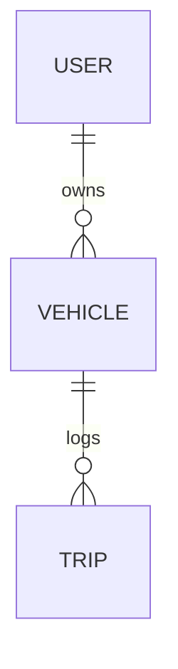
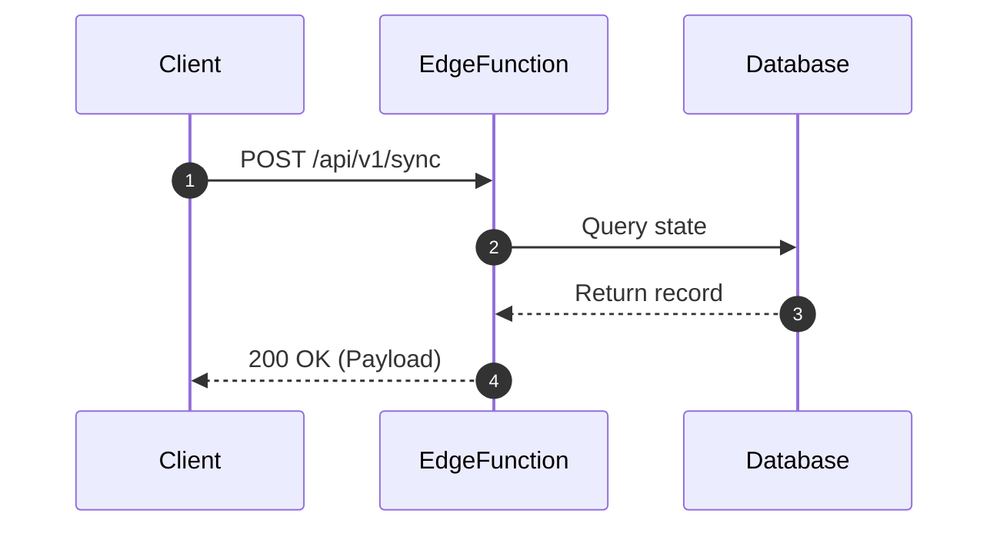

# Confluence Wiki Page Templates (4-Pillar Taxonomy)

Standard layout templates for the 4-Pillar Wiki architecture: Concepts, Entities, Features, and Flows.

---

## 1. Root Portal: Project Architecture & Domain Wiki

```markdown
# 📦 [Project Name] — Architecture & Domain Wiki

Welcome to the central technical and domain knowledge base for **[Project Name]**.
This living wiki is automatically synchronized from specification-driven development (SDD) artifacts in the codebase.

---

### Navigation Pillars

| Section | Description | Target Audience |
|---|---|---|
| **🧠 1. Conceptos** | Ubiquitous language, domain dictionary, and cross-cutting business rules | Product Owners, Developers, QA |
| **🗄️ 2. Entidades** | Database schemas, JSON contract schemas, and data structures | Backend Developers, Architects |
| **🚀 3. Features** | Living specifications, INVEST user stories, and acceptance criteria | Full Engineering Team, Stakeholders |
| **🔄 4. Flows** | Sequence diagrams, state machines, and asynchronous event lifecycles | Architects, QA, Mobile/Web Devs |
```

---

## 2. Pillar 1: Concept Page Template (`Conceptos`)

```markdown
# 🧠 Concept: [Domain Concept Name]

## 1. Definition & Bounded Context
Concise description of the business term, avoiding technical implementation details.

## 2. Ubiquitous Language Dictionary
| Term | Business Meaning | Synonyms / Deprecated Terms |
|---|---|---|
| `[Term 1]` | Strict domain definition | [Deprecated alias] |
| `[Term 2]` | Strict domain definition | [Deprecated alias] |

## 3. Invariant Business Rules (BR-xx)
- **BR-01**: [Universal business constraint]. *Failure consequence: [Result]*
- **BR-02**: [Universal business constraint]. *Failure consequence: [Result]*
```

---

## 3. Pillar 2: Entity Page Template (`Entidades`)

```markdown
# 🗄️ Entity: [Entity Name]

## 1. Entity Overview
- **Storage Target**: [e.g. PostgreSQL table `vehicles` / In-memory State]
- **Primary Key**: `id` (UUID v4)
- **Security / RLS**: [e.g. Enforced `auth.uid() = user_id`]

## 2. Attribute Schema
| Field | Type | Nullable | Default | Description |
|---|---|---|---|---|
| `id` | UUID | No | `gen_random_uuid()` | Immutable primary key |
| `created_at` | TIMESTAMPTZ | No | `now()` | Audit creation timestamp |

## 3. Entity Relationships (ERD)

```

---

## 4. Pillar 3: Feature Page Template (`Features`)

```markdown
# 🚀 Feature: [Feature Name] ([FEATURE_KEY])

## 1. Executive Summary & Value Hypothesis
**Problem Statement**: [User friction point]
**Value Hypothesis**: [Expected business/UX impact]

## 2. Numbered Acceptance Criteria (Given / When / Then)
### AC-01: [Happy Path Scenario]
- **Given** [Prerequisite condition]
- **When** [Action triggered]
- **Then** [Expected outcome]

### AC-02: [Edge / Error Case]
- **Given** [Error condition]
- **When** [Action triggered]
- **Then** [Expected recovery / error state]
```

---

## 5. Pillar 4: Flow Page Template (`Flows`)

```markdown
# 🔄 Flow: [System Flow Name]

## 1. Flow Overview
- **Trigger**: [User action / Webhook event / Cron schedule]
- **Participants**: [Mobile Client, Edge Function, Database, External API]

## 2. Sequence Diagram


## 3. Error Recovery & Fallbacks
| Failure Point | HTTP / Error Code | User Remediation |
|---|---|---|
| Network Timeout | 504 / Offline | Local cache fallback |
```
