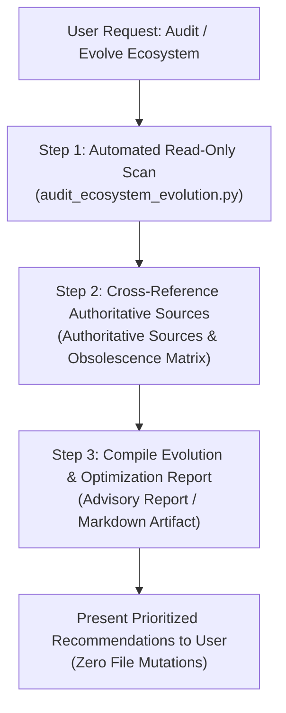

# Ecosystem Evolution & Agentic Radar

The `ecosystem-evolution` skill audits the agentic ecosystem against the latest state of the art in autonomous AI engineering, token economy, and multi-agent coordination. It provides continuous surveillance of emerging best practices and benchmarks existing workflows against authoritative standards.

> [!IMPORTANT]
> **STRICT NEGATIVE CONSTRAINT: READ-ONLY AUDIT & REPORTING ONLY**
> This skill **NEVER directly modifies, edits, or rewrites** codebase files or configuration schemas automatically. Its sole operational deliverable is an **Advisory Evolution & Optimization Report** with prioritized recommendations for human architects.

---

## When to Use This Skill

- When the user asks: *"¿Está nuestro ecosistema actualizado con las últimas prácticas agénticas?"*, *"Audita si hay patrones obsoletos en los agentes"*, or *"¿Cómo podemos optimizar la arquitectura del ecosistema?"*.
- Before major releases or quarterly architectural reviews of the multi-agent system.
- When new Antigravity platform updates, MCP protocol revisions, or context engineering whitepapers are published.

---

## 4 Pillars of Surveillance

1. **Antigravity Platform Standards**: Progressive disclosure tiers, prefix stabilization, workspace rule scopes, and SDK tool boundaries.
2. **Model Context Protocol (MCP)**: JSON-RPC 2.0 schemas, decoupled tool-resource servers, and standard integrations.
3. **Context Engineering & Token Economy**: Chatter elimination, KV-cache reusability, line budgets ($\le 150$), and prompt hygiene.
4. **Spec-Driven Development (SDD)**: Artifact-driven state machine transitions, Draft-07 machine-readable contracts, and HITL approval gates.

---

## Execution Workflow (Read-Only)



### Step 1: Execute Read-Only Diagnostic Scanner
Run the bundled diagnostic script to scan the ecosystem structure without altering any files:

```powershell
python skills/ecosystem-evolution/scripts/audit_ecosystem_evolution.py
```

Optional JSON export:
```powershell
python skills/ecosystem-evolution/scripts/audit_ecosystem_evolution.py --json
```

### Step 2: Cross-Reference Authoritative Knowledge
Evaluate findings against:
- [Authoritative Sources Reference](./references/authoritative_sources.md): Canonical standards (Antigravity SDK, MCP, DeepMind).
- [Agentic Obsolescence Matrix](./references/agentic_obsolescence_matrix.md): Legacy anti-patterns vs modern standards.

### Step 3: Produce the Evolution & Optimization Report
Synthesize the advisory report structured as:
1. **Executive Summary & Modernization Score** ($0 - 100$).
2. **Current Alignment vs. State-of-the-Art**: Detailed breakdown across the 4 pillars.
3. **Obsolescence & Technical Drift Risks**: Anti-patterns detected (chatter, prompt bloat, missing schemas).
4. **Prioritized Recommendations**: Concrete, phased improvements ranked by Impact vs. Effort.
