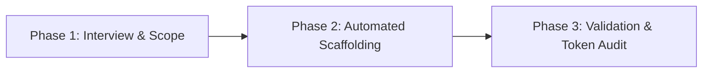

# Skill Creator & Scaffolder

The `skill-creator` skill standardizes how new agent skills are designed, scaffolded, and validated across repositories that adopt the agentic ecosystem. It enforces strict Antigravity conventions, progressive disclosure, and token budget hygiene.

---

## Skill vs. Rule vs. Agent Decision Matrix

Before creating a skill, ensure that a **Skill** is the correct customization type:

| Need | Right Mechanism | Where It Lives |
|---|---|---|
| Invariant project constraints (e.g., "Always use MVI", "Never bypass RLS") | **Rule** | `AGENTS.md` or `.agents/rules/*.md` |
| Multi-step operational runbook, tool workflow, or specialized procedure | **Skill** | `.agents/skills/<name>/SKILL.md` |
| Autonomous lifecycle persona with input/output contracts and schemas | **Agent Role** | `AGENTS.md` + `packs/<platform>/roles/` |
| One-off shell command or pure code helper | **Script** | `scripts/*.py` |

---

## 3-Phase Creation Lifecycle



### Phase 1: Interview & Scope Clarification
When a user requests a new skill, gather or clarify:
1. **Name**: Unique kebab-case identifier (e.g. `supabase-migration`, `datadog-alerts`).
2. **Trigger & Boundaries**:
   - Exact triggering phrases and user intents.
   - Anti-triggers (when this skill should *not* intervene).
3. **Helper Scripts**: Are there deterministic CLI actions that should be encapsulated into Python/Bash scripts?
4. **Documentation Depth**: Does it need deep reference files (`references/`)?

### Phase 2: Automated Scaffolding
Execute the companion scaffolder script:

```powershell
python skills/skill-creator/scripts/scaffold_skill.py `
  --name <skill-name> `
  --description "<third-person trigger description>" `
  --target .agents/skills `
  --scripts helper.py `
  --references api_guide.md
```

Options:
- `--target`: Use `.agents/skills` for project-specific skills, or `skills/` for ecosystem-wide core skills.
- `--scripts`: Comma-separated script names to generate in `scripts/`.
- `--references`: Comma-separated markdown files to generate in `references/`.
- `--with-examples`: Generates an `examples/` directory.

### Phase 3: Content Authoring & Validation
1. Populate `SKILL.md` following progressive disclosure:
   - Keep `SKILL.md` under 120 lines.
   - Put detailed schemas, logs, or API tables in `references/`.
2. Validate compliance:
```powershell
python skills/skill-creator/scripts/scaffold_skill.py --validate .agents/skills/<skill-name>
```
3. Run ecosystem audit if operating in an ecosystem repository:
```powershell
python scripts/workflow.py audit
```

---

## In-Depth References

- [Skill Anatomy & Progressive Disclosure Standards](./references/skill_anatomy.md)
- [Token Economy & Budgeting Guidelines](./references/token_economy_guidelines.md)
